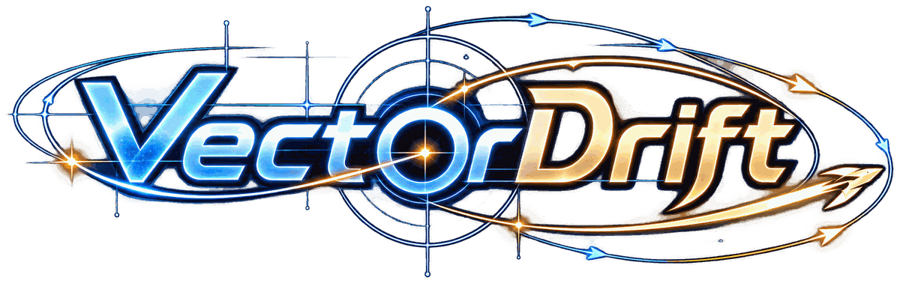

# Vector Drift



**Shape the field. Guide the ship.**

Vector Drift is a 2D physics puzzle game built with Python and Pygame. Instead of steering a spaceship directly, you write two mathematical expressions that define the force acting on it at every position:

\[
\mathbf{F}(x,y) = (F_x(x,y), F_y(x,y)) \quad [\mathrm{N}]
\]

Design a vector field, launch the ship, and see where the physics takes it. Reach the target, work around obstacles, use pickups, and refine your equations when a flight does not go as planned.

## Features

- **Mathematical force-field editor** — write general expressions in `x` and `y`, with syntax highlighting, validation, error locations, and independent undo/redo histories for `Fx` and `Fy`.
- **Physics-based flight** — acceleration, velocity, momentum, bumper collisions, force-field visualization, trajectory trails, and live telemetry.
- **Campaign levels** — handcrafted challenges introduce bouncing, shockwaves, wormholes, extra time, Unbound, and checkpoints.
- **Procedural level generation** — Level 8 builds a new obstacle course from a generated route and one of its level-generation templates.
- **Pickups** — shockwave, extra time, shield, life, money, and Unbound each have a distinct effect.
- **Hints and offline AI Solver** — fixed campaign levels use authored step-by-step hints; random and custom levels use a Particle Swarm Optimization (PSO) solver.
- **Custom level editor** — create, edit, save, and play your own layouts.
- **Community levels** — browse public levels and upload or delete your own levels through an optional Supabase backend.
- **Replays** — review the latest ten launches, including the formulas, trajectory, force and velocity data, and the state of the level.
- **Progression and persistence** — earn coins, buy ship skins, keep best times, and save progress locally or to an optional online account.
- **Music and art** — music, sound effects, and replaceable image/audio assets.

## Current game content

The level selector displays 24 planned level slots. A displayed slot is not necessarily playable yet.

| Level | Name | Current content |
|---:|---|---|
| 1 | First Drift | Introductory force-field level. |
| 2 | First Bounce | A bumper obstacle and a coin pickup. |
| 3 | First Blast | A ring of bumpers and shockwave pickups. |
| 4 | First Wormhole | A wall of bumpers, a black/white wormhole pair, and a coin pickup. |
| 5 | First Extratime | A shorter time limit, bumper obstacles, and an extra-time pickup. |
| 6 | First Unbound | A curved wall of bumpers that introduces the Unbound pickup. Its authored hint is still pending. |
| 7 | Coming soon | Placeholder; not currently a playable random level. |
| 8 | Random Drift | Procedurally generated layouts. The generator currently selects between two complete presets. |
| 9 | New Horizon | A two-section level connected by a checkpoint. |
| 10–24 | Coming soon | Placeholder level slots. |

The current fixed campaign consists of Levels **1–6 and 9**. Level **8** is the only registered procedural level in this snapshot. The level selector reserves the other numbered slots for future content.

### Level 8 generation

Level 8 is generated when it is entered from the level selector. The generator chooses one of two complete presets, places a start and target, builds a hidden waypoint route between them, and places obstacles outside a clearance corridor around that route. It also ensures that obstacles block the direct start-to-target line, so a straight-line solution is not enough.

The two presets differ in time limit, lives, target size, obstacle density, and pickup groups:

- One preset uses a 10-second limit and 5 lives, with 5–20 obstacles, money/life pickups, and two black/white wormhole pairs.
- The other uses a 12-second limit and 3 lives, with 10–18 obstacles and groups of shockwave, extra-time, shield, life, and money pickups.

A generated map is identified by a seed. Retrying the same run or replaying it uses the same layout; entering Level 8 as a new run generates a new seed and layout.

## How a flight works

The player edits the two components of the force field, checks the field preview, and launches the ship. The ship starts with zero velocity at the current section's launch point. Its acceleration follows the force at its current position and its mass:

\[
\mathbf{a}(x,y) = \frac{\mathbf{F}(x,y)}{m}
\]

All six ship skins use the same physical values: **1 kg mass** and **0.2 m hull radius**. A skin changes appearance, not handling.

The simulation uses a fixed **1/120-second** physics step and semi-implicit Euler integration. The application renders at up to 60 frames per second. The default visible world spans approximately `x = -10..10 m` and `y = -7.5..7.5 m`.

### What the game displays

- A grid and coordinate axes for the two-dimensional world.
- Arrows showing the force field at sampled positions.
- The ship's trajectory and velocity/force vectors.
- Live position, velocity, and force telemetry.
- A time limit and remaining-life indicators.
- A camera that zooms out while an Unbound ship travels beyond the normal map.

### Obstacles and wormholes

Bumper rocks are circular obstacles. The ship bounces from them according to the obstacle's restitution value; the built-in campaign bumpers use an elastic restitution of `1.0`. Collision checks use the ship's movement segment rather than only its final position, reducing the chance that a fast ship tunnels through a small obstacle.

A black hole is paired with a white hole. Touching the black hole transports the ship to its paired white hole while preserving its velocity. The trail is split at the teleport instead of drawing a misleading line between the two locations.

### Flight outcomes and lives

A level supplies its own time limit and number of lives. Many levels use 10 seconds and 5 lives, but this is not universal: for example, Level 5 has 9 seconds, and the two Level 8 presets have different limits and life counts. Every failed launch costs one life.

* ​**Time up**​: the next launch starts at rest where the ship stopped, provided it stopped inside the normal map.
* ​**Abort / Out of bounds / Diverged**​: the next launch starts at the beginning of the current section. The stop button and the pause-menu Abort action both abort an active flight.
* ​**Invalid mathematical result**​: a valid expression can still be undefined at a position. For example, `log(-1)` has no real result. If a force expression cannot produce a valid finite value during flight, the launch fails and costs a life.
* ​**Infinite force**​: a force can have a pole even when the expression parses successfully. Examples include `tan(x)` at `x = ±π/2`, `1/x^2` at `x = 0`, and `log(abs(x))` at `x = 0`. Passing through a detected pole normally sends the ship out of bounds. A finite removable singularity such as `sin(x)/x` at `x = 0` is treated as finite and can be crossed.

When the last life is lost, the fail screen ends the attempt. Restarting the level begins again from its first section with the level's full life count. A level's best time is based on the total flight time across its sections.

### Unbound

The **Unbound** pickup opens the map edge for the rest of the current life:

- For the rest of that life the ship **never goes out of bounds**: it may fly as far from the map as it likes, and the camera zooms out to keep both the map and the ship in view. The map edge itself cannot end the flight. Normal flight outcomes still apply (reaching the target, time running out, or divergence), and the player can always abort manually.
- If the ship crosses a point of infinite force while Unbound is active, the result is **Diverged** rather than being flung out of bounds.
- Unbound comes back at the start of **every life**. Other pickups that have already been collected stay taken until the section or level is reset.
- If time runs out while the ship is **outside the map**, the next launch starts at the **level start** (or current section start), not at the off-map stopping point.
- A shield does not protect the ship from the map edge. With Unbound active, crossing the edge does not consume the shield; the shield remains available for a bumper collision.

## Pickups

| Pickup | Effect |
|---|---|
| **Shockwave** | Emits a blast with a 3 m radius. It destroys each obstacle whose edge touches or overlaps the blast area. |
| **Extratime** | Adds 3 seconds to the current flight's time limit. |
| **Shield** | Lasts 3 seconds. The next bumper collision during that period is survived; the shield is consumed and the ship passes through that bumper. It does not protect against leaving the map. |
| **Life** | Restores one life, up to the level's maximum. |
| **Money** | Collects one coin, subject to the payout rules in [Coins](#coins). |
| **Unbound** | Prevents the ship from going out of bounds for the remainder of the current life. It respawns at the start of each new life. |

Pickup collision is checked along the ship's movement segment, so a fast ship can collect a pickup between simulation positions. Each pickup triggers once per placement/lifecycle.

## Checkpoints

The current multi-section campaign level is Level 9, **New Horizon**, which contains two sections. The same multi-section data model can represent levels with additional sections.

- The target of every section except the last is a checkpoint, shown as a white square/portal rather than the final planet.
- Reaching a checkpoint advances to the next section, pans the camera, and restores one life, capped at the level's maximum.
- The checkpoint becomes the next section's launch point. If a life is lost after reaching it, the next launch starts from that checkpoint rather than the beginning of the level.
- A time-out inside the map still resumes at the point where the ship stopped.
- Losing all lives or choosing Restart resets the entire level to its first section with full lives.
- Each section has its own time limit for each launch. The recorded best time adds the flight times from all sections.

## Hints and AI Solver

The game chooses between an authored Hint and the AI Solver based on the level type.

### Hints for fixed campaign levels

Fixed levels use hand-written, step-by-step hints loaded from `vector_drift/hints.toml`. Hint steps are free and are shown one at a time. The final answer page contains one or more complete `Fx`/`Fy` formula pairs.

Current hint coverage is:

- Levels 1–5: one hint per level.
- Level 9: one hint for each of its two sections.
- Level 6: the hint and reference answer are still pending play-testing; no authored hint is currently available.

The answer page is free on **levels 1 and 2**, and on **level 9**. On Levels 3–5, opening the answer page costs 10 coins after confirmation. A paid answer is charged once per level per game launch; later views during that launch do not charge again. Applying a displayed answer fills both formula fields and resets the current section to its start/checkpoint. Paying for the answer is the only cost: coins collected during the run, the clear reward, and the best time all count as usual.

### Offline AI Solver for random and custom levels

Level 8 and player-created/custom levels use the AI Solver instead of authored hints. The solver also works on community levels after they are loaded as custom levels.

The current implementation uses **Particle Swarm Optimization (PSO)**. It searches a parameterized family of force fields, evaluates candidates with the same `Flight` physics used by gameplay, and regards a candidate as a solution only if the simulated flight actually reaches the target (`Outcome.REACHED`). Search runs in the background and does not require a network connection.

The default `all_in_one` template combines target attraction, rotational/swirl terms, quadratic terms, trigonometric-polynomial terms, and richer trigonometric/logarithmic/polynomial terms. Other available templates include:

- `target_attract`
- `attract_damp`
- `general_poly`
- `swirl_attract`
- `trig_poly`
- `rich_combo`
- `all_in_one`

The in-game PSO solver uses a 150-particle swarm and keeps searching in the background until it is cancelled (for example, when leaving the level). When it finds a verified solution, it publishes the candidate and continues searching for further candidates. The solver configuration also defines a 100,000-simulation limit for runs supplied with a time budget; the current in-game call does not supply that budget, so this value is not a hard cap on an ordinary in-game search. A high fitness score alone is not considered a completed solution.

Opening the solver and running the search are free. The candidate formulas remain hidden until **Reveal** is purchased for 10 coins. One reveal payment covers that level/map for the current game launch. After revealing, **Apply** places the formulas in the editor.

Paying to reveal a complete answer costs 10 coins; that is the only cost. Coins collected during the run still pay out, the clear reward is still granted, and the clear still sets a best time. Applying the answer resets the current section to its start/checkpoint (lives stay).

## Coins

Coins are the game's progression currency. They are shown in the level selector, game screen, and shop. Prices the player cannot afford are shown in red.

- **Coin pickups:** a coin pickup on a fixed level pays once, ever. A coin pickup on a random level pays once per generated map; entering a new map can make a new set of coins available.
- **Clearing a level:** reaching the final target pays 5 coins. On a fixed level this happens once, ever, on the first eligible clear, and is saved with progress. On a random level it pays 5 coins once per map/seed; retrying the same map does not pay again, while a newly generated map can.
- **Hint answers:** the answer page is free on **levels 1 and 2** and Level 9. On Levels 3–5 it costs 10 coins after confirmation, once per level per game launch. Level 6 currently has no authored hint.
- **AI Solver:** background solving is free. **Reveal** (10 coins) unlocks the formulas for the current level/map during that game launch; a new random map needs a new reveal.
- **Solution-assisted runs:** when an answer is revealed, coins earned earlier in that run are **taken back** and their pickups can be collected again after a reset. Pickups collected after revealing do not pay out for that run. A solution-assisted clear receives no clear reward; the reward remains available for a later clear without revealing a solution.
- **Custom levels:** custom/community levels can contain money pickups, but playing them does not add those pickups to the player's coin balance and does not pay the campaign/random clear reward.

The relevant constants are in `vector_drift/config.py`: `HINT_ANSWER_COST`, `AI_SOLVER_COST`, `FREE_ANSWER_LEVELS`, and `CLEAR_REWARD`.

## Ships and Shop

There are six visual ship skins: `ship01` through `ship06`. `ship01` is owned by default; the other five are purchased in the Shop with coins. Their prices are 20, 30, 40, 50, and 60 coins respectively. All six use the same 1 kg mass and 0.2 m hull radius, so purchases are cosmetic and do not change the physics.

The current shop catalog contains ship skins. Owned ships can be selected with the previous/next ship arrows on the game screen. A locked ship cannot be used until it has been purchased.

## Custom Level Editor

Open **Level Editor** from the level selector, then choose **New** or select one of your saved custom levels.

The editor supports:

- A start point and a target (with an adjustable target radius).
- Circular bumper obstacles.
- All six pickup types: shockwave, extratime, shield, life, money, and Unbound.
- Dragging objects to reposition them.
- Resizing the selected target, obstacle, or pickup from 0.1 m to 5.0 m.
- Saving a named custom level locally and editing or deleting saved custom levels later.

Objects are not allowed to overlap. Use the mouse wheel or `+`/`-` to resize the selected object. Right-click an object to open its context menu; `Delete` or `Backspace` removes the selected object.

The current editor does **not** expose controls for custom time/life settings, wormhole pairs, or multi-section/checkpoint layouts. Newly created editor levels use the default level settings (10 seconds and 5 lives).

Custom levels can be played locally and are included in local/cloud player progress. Custom levels do not earn coin payouts or campaign clear rewards.

## Public Community Levels

The **Public Levels** page is part of the Level Editor menu.

- Public levels are fetched from the Supabase `community_levels` table and shown newest first with a small layout preview, uploader email, and upload date.
- Browsing and downloading public levels require a configured Supabase backend but do not require the player to sign in, provided the table's public-read policy is enabled.
- Uploading requires a configured backend and an authenticated account.
- A player can delete their own uploaded levels. Supabase Row Level Security also restricts deletion to the owning user.
- Opening a community level loads it into the local custom-level list so it can be played like another custom level.

Community features use the built-in Supabase backend by default. Players do not need to provide their own credentials to browse public levels or use online account features.

Players can optionally configure their own Supabase project through a .env file. When custom credentials are provided, they override the built-in configuration.

If neither a built-in configuration nor a valid custom configuration is available, local gameplay and locally saved custom levels remain available, but online account and community operations cannot connect.

## Replays

The Replays screen is available from the main menu. The game keeps the **10 most recent launches** in the player profile.

A replay record includes the level and section, selected ship, `Fx`/`Fy` expressions, outcome, and (for procedural maps) the random seed. Its recorded frames contain time, position, velocity, and force data. The record also preserves relevant pickup/obstacle state so the replay can reconstruct a run after pickups were consumed or a shockwave destroyed rocks. Wormhole transitions break the trail rather than drawing a line across the map.

Replay controls:

| Input | Action |
|---|---|
| Play / Pause buttons | Start or pause playback. |
| `Space` | Toggle playback and pause. |
| `Left` / `Right` | Pause and step one recorded frame backward/forward. |
| Previous / Next buttons | Switch between saved launch records. |
| Speed `-` / `+` buttons | Change playback speed from 0.1× to 2.0× in 0.1× increments. |
| `Esc` / Back | Return to the main menu. |

## Story, Music, and Art

The game currently has no story: levels open, finish, and lose lives without dialogue, and **Start** goes straight to the level selector. A new story (the Cosmic Architect comic on the main menu, leading into a tutorial mode) is planned separately. Older saves may still contain a `story_seen` entry in their stats; it is ignored on load and no longer written.

Every level's target uses the same planet artwork, `assets/images/targets/planet.png`; if that image cannot be read, the game draws its built-in planet instead.

Music tracks are assigned to the menu and gameplay scenes. The opening track in `assets/music/` is kept for the planned story comic but is not played at the moment. The pause menu has independent Music and Sound switches; `Ctrl+M` toggles the global mute state. Music and sound files are loaded from `assets/music/` and `assets/sounds/`. Missing audio files or an unavailable audio device leave the relevant slot silent rather than preventing the game from running.

Image assets are loaded from `assets/images/`. If an image is missing or unreadable, the game falls back to its Pygame-drawn artwork. The asset slots, file names, sizing, and recommended sources are documented in `assets/README.md` and `assets/images/README.md`.

## Run

### Requirements

- Python **3.11 or newer** (`tomllib` is used to read the TOML hint file).
- The packages listed in `requirements.txt`.

### Install and launch

Clone the repository:

```bash
git clone https://github.com/01huan/VectorDrift.git
cd VectorDrift
```

Create and activate a virtual environment (recommended):

**Windows PowerShell**

```powershell
py -3.11 -m venv .venv
.venv\Scripts\Activate.ps1
```

**macOS / Linux**

```bash
python3.11 -m venv .venv
source .venv/bin/activate
```

Install dependencies and start the game:

```bash
python -m pip install --upgrade pip
python -m pip install -r requirements.txt
python main.py
```

### Display options

By default, the game opens a borderless desktop-sized window and draws on a 1280×720 logical canvas. The layout scales to fit the available display; unused strips on non-16:9 displays are filled with the background color. On Windows, the application enables DPI awareness to keep the UI sharp on high-DPI displays.

- `VECTOR_DRIFT_WINDOWED=1` runs the game in a regular window.
- `VECTOR_DRIFT_SCALE` forces a UI scale, for example `1`, `1.5`, or `2`.

Examples:

```powershell
$env:VECTOR_DRIFT_WINDOWED = "1"
python main.py
```

```bash
VECTOR_DRIFT_WINDOWED=1 python main.py
```

The formula editor detaches from the operating-system input method while the game is active so keyboard input is handled by the editor. Use `Quit` in the main menu or `Alt+F4` to close the game.

## Controls

### Main menu and navigation

| Input | Action |
|---|---|
| `Enter` or Start | Open the level selector. |
| `L` | Open Login or Account. |
| `Ctrl+M` | Toggle global mute. |
| `Esc` in the level selector | Return to the main menu. |
| Shop / Level Editor buttons | Open the ship shop or custom-level tools. |
| Replays button | Open saved launch replays. |

### In a level

| Input | Action |
|---|---|
| `Enter` or the Play button | Launch when both force expressions are valid and the selected ship is owned. |
| Stop button during flight | Abort the flight and lose one life. |
| `Esc` | Open the pause menu. Resume, Abort flight, Restart, Levels, Main Menu, and Quit are available there; Music and Sound can be toggled separately. |
| `Esc` with a popup open | Close the topmost Hint or AI Solver popup first. |
| `Tab`, `Up`, or `Down` | Switch between the `Fx` and `Fy` editor lines. |
| Mouse drag / double-click | Select text in the active formula line. |
| `Shift` + Arrow / `Home` / `End` | Extend the text selection. |
| `Ctrl+A`, `Ctrl+C`, `Ctrl+X`, `Ctrl+V` | Select all, copy, cut, and paste in the active line. |
| `Ctrl+Z` | Undo in the active formula line. |
| `Ctrl+Shift+Z` or `Ctrl+Y` | Redo in the active formula line. |

The formula editor also supports paired-parenthesis editing: typing `(` around a selection wraps it; typing `(` at the end of an expression (or before a space) inserts a matching `)` and places the cursor inside; typing `)` before an existing matching close parenthesis moves past it; Backspace inside an empty `()` removes the pair. `Fx` and `Fy` maintain separate edit histories.

### Level editor

| Input | Action |
|---|---|
| Left-click a palette item, then release in the playfield | Place a start, target, obstacle, or pickup. |
| Left-click and drag an object | Move it. |
| Right-click an object | Open its Delete / Modify context menu. |
| Mouse wheel | Resize the selected resizable object. |
| `+` / `-` | Increase / decrease the selected object's radius. |
| `Delete` / `Backspace` | Delete the selected object. |

## Formula Language

Each editor line is one real-valued mathematical expression. The only position variables are `x` and `y`; constants are `pi` and `e`. An empty expression is interpreted as zero.

### Operators and syntax

- Arithmetic: `+`, `-`, `*`, `/`.
- Powers: `^` and `**`.
- Parentheses and unary `+` / `-`.
- Implicit multiplication: `2x`, `2(x + 1)`, `(x + 1)y`, `2pi`, and `2sin(x)`.
- Function arguments are separated by commas.

### Built-in functions

`sin`, `cos`, `tan`, `asin`, `acos`, `atan`, `sinh`, `cosh`, `tanh`, `exp`, `log`, `ln`, `log10`, `sqrt`, `abs`, `floor`, `ceil`, `min`, and `max`.

`log` accepts one argument (natural logarithm) or two arguments (value and base). `ln` is the one-argument natural-logarithm alias. `min` and `max` take two arguments. Trigonometric functions use radians.

Examples:

```text
Fx = 2x + y
Fy = sin(y) - x^2

Fx = -(x + y) / 2
Fy = sin(x) * cos(y)

Fx = 3 * (7 - x)
Fy = log(abs(y) + 1)
```

The editor validates syntax and shows parse errors with a location. A formula may parse successfully but still be undefined or too large at a particular position. The parser and physics layer reject non-finite or excessive values rather than passing arbitrary coordinates to the renderer. The expression parser is a dedicated parser; it does not execute arbitrary Python code.

Implementation guardrails include a 1,000-character editor input limit, a longer parser-side text limit for restored/direct inputs, finite-result checks, a per-component force limit for `Fx` and `Fy`, and a per-step displacement limit. The canonical values are in `vector_drift/config.py`.

## Optional Supabase Setup

Supabase powers email/password accounts, cloud profile synchronization, and the Public Levels service.

The game comes with a default Supabase configuration, so players can use online features without setting up their own Supabase project or creating a .env file.

Players who prefer to use their own Supabase backend can override the default configuration by creating a .env file in the project root.

### Use the default Supabase backend
No additional configuration is required. Simply launch the game, and the built-in Supabase configuration will be used automatically.

### Use your own Supabase project

1. Create a Supabase project.
2. In the project's Authentication settings, enable the Email provider and configure email confirmation/password recovery to match your project.
3. Open the Supabase SQL Editor and run [`docs/supabase_schema.sql`](docs/supabase_schema.sql). It creates the `profiles` and `community_levels` tables, their Row Level Security policies, and the profile-creation trigger.
4. Copy `.env.example` to `.env` and replace the placeholder values with your own project URL and public anon key:

   ```dotenv
   SUPABASE_URL=https://YOUR_PROJECT.supabase.co
   SUPABASE_KEY=YOUR_SUPABASE_ANON_KEY
   ```

   `SUPABASE_ANON_KEY` is also accepted as an alternative environment variable name.

5. Restart the game. The Login screen supports account registration, email/password sign-in, and requesting a password-reset email. Existing sessions can be restored on startup.

Use only the project's public anon/publishable client key in this desktop client. **Never put a Supabase service-role key in `.env` or commit credentials to the repository.** The database policies are part of the security boundary; review them before deploying a modified schema.

### What is saved

Guest progress is saved locally under `~/.vector_drift/guest_profile.json`. The local account session (refresh token, not the password) is stored separately under `~/.vector_drift/account_session.json` when signed in.

The player profile can include coin balance, owned ships, purchased items, best-time records, the latest ten replays, collected fixed-level money pickups, clear-reward progress, custom levels, and other stats. With Supabase configured and a user signed in, the profile is synchronized through the `profiles` table. Local guest progress and cloud progress are reconciled using their update timestamps.

The SQL schema enables Row Level Security on both tables. A player can read/insert/update their own profile; community levels are publicly readable, authenticated users can upload, and only the uploader can delete their own row. The game code also checks ownership before showing a delete action.

## Project Structure

```text
VectorDrift/
├── main.py                         # Application entry point and Pygame loop
├── requirements.txt                # Runtime and test dependencies
├── .env.example                    # Optional Supabase configuration template
├── docs/
│   └── supabase_schema.sql         # Supabase tables, triggers, and RLS policies
├── assets/
│   ├── images/                     # Ships, planets, obstacles, pickups, UI
│   ├── music/                      # Menu, opening, and level music
│   └── sounds/                     # Sound-effect slots
├── tools/
│   ├── make_music.py               # Music-generation utility
│   └── make_sounds.py              # Sound-generation utility
├── tests/                          # Pytest suite
└── vector_drift/
    ├── config.py                   # Display, gameplay, physics, and economy constants
    ├── data.py                     # Ship and level specifications
    ├── level_presets.py            # Procedural-level generation presets
    ├── random_level.py             # Seeded level generator
    ├── expr_parser.py              # Mathematical expression parser/evaluator
    ├── physics.py                  # Force fields and flight simulation
    ├── pickups.py                  # Pickup lifecycle and effect registry
    ├── hints.py / hints.toml       # Fixed-level hints and answer formulas
    ├── replay.py                   # Replay records and playback data
    ├── render.py                   # World, grid, and force-field rendering
    ├── sprites.py                  # Ships, planets, obstacles, pickups, effects
    ├── image_assets.py             # Image lookup, fallback, and size cache
    ├── audio.py                    # Music and sound-effect loading/playback
    ├── background.py               # Background/field layer work
    ├── coords.py                   # World-to-screen coordinate transforms
    ├── ui.py                       # Buttons, code editor, text and UI helpers
    ├── shop.py / money.py          # Shop catalog and currency
    ├── account/                    # Auth, local profiles, Supabase, community
    ├── solver/                     # Solver API, PSO, templates, evaluation, data
    └── scenes/                     # Menu, gameplay, editor, account, replay, etc.
```

## Development

### Run the tests

Install the dependencies first, then run:

```bash
python -m pytest tests
```

The test suite covers expression parsing/evaluation, physics and edge cases, level definitions and generation, pickups, hints, checkpoints, replay reconstruction, custom/community levels, account/profile integration, solver behavior, UI interactions, and README rules.

### Add or change a fixed level

1. Add a `LevelSpec` to `vector_drift/data.py` and register it in `LEVELS`.
2. Add the level's hint to `vector_drift/hints.toml` as `[level.N]`, including `steps`, `answer_note`, and at least one valid `Fx`/`Fy` answer. A multi-section level uses one `[level.N.section.K]` entry for every section.
3. Run the tests. Hint-answer tests simulate the supplied formulas with the actual flight physics and expect them to reach the appropriate target.

Level 6 is the current fixed-level exception: its hint is explicitly marked as pending play-testing in `tests/test_hints.py`.

### Add a random level

Register a `RandomPreset` in `vector_drift/level_presets.py`. `vector_drift/random_level.py` builds seeded layouts from start/target positions, hidden route waypoints, obstacle-placement rules, pickup groups, and optional wormhole placement. `data.all_levels()` adds a level-selector card for each registered dynamic preset.

### Add a pickup type

`vector_drift/pickups.py` uses an effect registry. The module documentation describes the extension points: register an effect with `@register_effect`, add a renderer in `sprites.PICKUP_RENDERERS`, and add the new kind to fixed-level data or a random preset's `pickup_groups`. Add it to the level-editor palette separately if the new pickup should be placeable in custom levels.

### Add a solver template

Register a `FieldTemplate` in `vector_drift/solver/templates.py`. A template renders parameter values into formula strings accepted by `expr_parser`. Candidate evaluation is centralized in `vector_drift/solver/engine.py` and runs through the formal `Flight` implementation, so candidate success uses the same reach/collision/time rules as the game.

### Change assets

- Image resource keys, file names, sizing, and fallback behavior: `vector_drift/image_assets.py` and `assets/images/README.md`.
- Music and sound slots: `vector_drift/audio.py` and `assets/README.md`.
- Hints and reference formulas: `vector_drift/hints.toml`.
- Display, physics, and economy constants: `vector_drift/config.py`.

## License and Asset Notes

No `LICENSE` file is included in this repository snapshot. Do not assume that the source code is licensed for unrestricted reuse; obtain permission or add an explicit license before redistributing or reusing it.

The asset documentation recommends CC0 sources for replacement assets, but that recommendation is not a substitute for verifying the license of each file already included in the repository. Check the applicable asset licenses before redistributing the bundled images, music, or sound effects.
