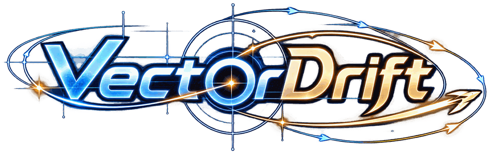

# Vector Drift



**Shape the field. Guide the ship.**

Vector Drift is a 2D physics puzzle game built with Python and Pygame. Instead of steering a spaceship directly, you write two mathematical expressions that define the force acting on it at every position:

\[
\mathbf{F}(x,y) = (F_x(x,y), F_y(x,y)) \quad [\mathrm{N}]
\]

Design a vector field, launch the ship, and see where the physics takes it. Reach the target, work around obstacles, use pickups, and refine your equations when a flight does not go as planned.

## Features

- **Mathematical force-field editor** — write general expressions in `x` and `y`, with syntax highlighting, validation, error locations, and independent undo/redo histories for `Fx` and `Fy`.
- **Function Lab** — write a force function of your own, watch the field it produces, choose where the probe starts, give it a name, save it in your library and import it into the normal levels.
- **Physics-based flight** — acceleration, velocity, momentum, bumper collisions, force-field visualization, trajectory trails, and live telemetry.
- **Campaign levels** — handcrafted challenges introduce bouncing, shockwaves, wormholes, extra time, Unbound, and checkpoints.
- **Procedural level generation** — the random level (Level 12, right after the last campaign level) builds a new course by merging one to three seeded generation modules (two corridor flavours, wormhole network, maze, extreme time) into a single multi-screen map whose screens are chained by checkpoints.
- **Daily Challenge** — one new map a day, the same for every player, built answer first so it always has a solution; coins and the clear reward pay once per day.
- **Procedural Level Validator** — every generated map is checked before play: fast path analysis (A*, route and seal checks) plus an AI Solver probe that confirms a solution exists under the formal physics; invalid maps are regenerated automatically.
- **Pickups** — shockwave, extra time, shield, life, money, and Unbound each have a distinct effect.
- **Hints and offline AI Solver** — fixed campaign levels use authored step-by-step hints; random and custom levels use a Particle Swarm Optimization (PSO) solver.
- **Custom level editor** — create, edit, save, and play your own layouts.
- **Community levels and functions** — browse, search and sort public content (fuzzy search by name and uploader; click the dropdown to pick a sort), favorite and rate it (five stars on the card), and publish or delete your own uploads through an optional Supabase backend.
- **Replays** — review the latest ten launches, including the formulas, trajectory, force and velocity data, and the state of the level.
- **Progression and persistence** — earn coins and [experience points](#experience-and-levels) that raise your player level, buy abilities, keep best times, and save progress locally or to an optional online account.
- **Music and art** — music, sound effects, and replaceable image/audio assets.

## Current game content

The level selector displays 24 planned level slots. A displayed slot is not necessarily playable yet.

| Level | Name | Current content |
|---:|---|---|
| 1 | First Drift | Introductory force-field level. |
| 2 | First Bounce | A bumper obstacle and a coin pickup. |
| 3 | First Blast | A ring of bumpers and shockwave pickups. |
| 4 | First Wormhole | A wall of bumpers, a black/white wormhole pair, and a coin pickup. |
| 5 | First Extratime | A shorter time limit, bumper obstacles, and an extra-time pickup. |
| 6 | First Unbound | An arc of bumpers runs from the top edge to the bottom edge between the ship and the planet; an Unbound pickup (top or bottom) lets the ship arch over or under it outside the map. |
| 7 | First Shield | A column of bumpers seals the middle, leaving narrow slits at the top and bottom edges; two Shield pickups let the ship pass through the wall or bounce off the edge round it. The ship flies right to left. |
| 8 | New Horizon | A two-section level connected by a checkpoint. |
| 9 | Ascent | Two sections, the first upward pan; section 1 reviews bouncing round rocks, section 2 reviews the shockwave. |
| 10 | Shortcut | Two sections, the first diagonal pan; section 1 reviews the wormhole, section 2 reviews the shield. |
| 11 | Off the Map | Three sections, two checkpoints, both pans to the left; every section reviews Unbound and changes one thing in the previous section's formula. |
| 12 | Random Drift | Procedurally generated layouts from five generation modules, merged into one to three screens (see below). |
| 13–24 | Coming soon | Placeholder level slots. |

The current fixed campaign consists of Levels **1–11**. Level **12** is the only registered procedural level in this snapshot. The random level is always shown right after the last campaign level, not in the last planned slot, so adding a campaign level moves its card one slot along. The level selector reserves the other numbered slots for future content.

### Level ids and level numbers

Every level has an **id** and a **number**, and they are not the same thing:

- The **id** is the level's identity in saved data: best times, clear rewards, achievements, collected coins and replays are all stored by id. Once a level is released its id never changes and is never reused.
- The **number** is only the level's place on the level select (the big number on its card, `Level N`, the `LV` label in the game panel and the replay label). Level number N flies `shipNN`.

A campaign level's number is its id. The random level's id is fixed at **999** (`RANDOM_LEVEL_ID` in `vector_drift/level_presets.py`), and it is numbered right after the last campaign level (`level_number` in `vector_drift/data.py`), so today it shows as Level 12. Adding a campaign level moves the random level's number, not its id, so the new level starts with no saved data of its own. Editor levels use ids from 1000 up and community levels negative ids. The [Daily Challenge](#daily-challenge) uses id **900** (`DAILY_LEVEL_ID`) and has no number: the game shows **Daily** (and **DAILY** in the game panel) instead.

### Random level generation

The random level (Level 12) is generated when it is entered from the level selector. The generator picks one to three complete module presets, builds one layout per preset with the usual single-layout flow, validates every layout (see [Procedural Level Validator](#procedural-level-validator)) and retries with a fresh seed if the validation finds a hard error. The layouts are then merged into one multi-screen level: every screen but the last ends on a checkpoint, so the ship flies on to the next screen instead of winning, and only the last screen's target is the planet. The lives are shared by the whole run. Every map is identified by a seed. Retrying the same run or replaying it uses the same layout; entering the random level as a new run generates a new seed and layout. Because every visit is a new map, the random level's card on the level selector shows how many maps have been cleared (**Maps cleared N**, saved with progress) instead of a best time.

The modules:

- **Corridor (Random Drift I / II)** — the original hidden-waypoint route. Obstacles are placed outside a clearance corridor around a hidden route and block the direct start-to-target line, so a straight-line solution is not enough. Template I uses a 10-second limit, 5 lives, 5–20 obstacles with money, extra-time, life and Unbound pickups and two black/white wormhole pairs; template II uses a 12-second limit, 3 lives, 10–18 obstacles and groups of shockwave, extra-time, shield, life, money and Unbound pickups.
- **Wormhole network (Random Drift III)** — full-height walls of bumper rocks seal the map behind gates. Each gate is a black/white wormhole pair and the hidden route chains through them, so the only way through a sealed sector is by teleporting. 12 seconds, 4 lives, money, life and Unbound pickups.
- **Maze (Random Drift IV)** — a braided perfect maze (randomized depth-first search with extra loops knocked out) whose walls are bumper rocks; the start and target sit in opposite corner cells. 15 seconds, 5 lives, money, extra-time, life and Unbound pickups.
- **Extreme time (Random Drift V)** — a winding slalom route against a very tight 6-second limit, with extra-time pickups placed along the route. 3 lives, extra-time, money and Unbound pickups.

Each template lists the pickup groups it places; the groups are drawn at random inside their range, so the number of pickups on a screen scales with the screen's difficulty instead of being fixed. A screen never ends up empty-handed and never turns into a treasure hunt.

### Procedural Level Validator

Generating a map is not enough: the random level also verifies the map before play. Every generated level is checked by `vector_drift/level_validator.py`:

**Fast path analysis** (always runs):

- Grid A* reachability from start to target — no map ships with every path blocked.
- The intended route's legs must be clear of obstacles.
- Wormhole walls must be sealed end to end (the route goes through the gates, not through a gap).
- Required pickups must be present and reachable from the start.
- Start and target must be inside the world bounds, far enough apart, and clear of the rocks.

**AI Solver probe** (small, configurable budget): a short PSO run searches for a real force field that reaches the target under the formal game physics, and the best candidate is independently re-simulated before being accepted. A passed probe confirms a non-trivial solution exists. A failed probe never rejects a map by itself, because the construction guarantees a path — set `require_solver_confirmed` in a preset's `ValidationProfile` to make the generator keep retrying until the probe succeeds.

**Difficulty heuristics** (warnings, never hard errors): an A* estimate of the minimum flight distance vs the time limit, and obstacle density.

**Formula dependence** (warning): trivial target-attraction fields are tested; a map solvable by one is flagged as too easy rather than silently shipped.

This all runs offline at map-entry time, typically well under a second (up to roughly a second for the densest maze maps). The report is available from `generate_random_level(..., return_report=True)` and is logged at debug level; it includes every check's result, the route, and the solver outcome. `get_level()` keeps the same signature and validates automatically.

## How a flight works

The player edits the two components of the force field, checks the field preview, and launches the ship. The ship starts with zero velocity at the current section's launch point. Its acceleration follows the force at its current position and its mass:

\[
\mathbf{a}(x,y) = \frac{\mathbf{F}(x,y)}{m}
\]

All ten ship skins use the same physical values: **1 kg mass** and **0.2 m hull radius**. A skin changes appearance, not handling.

The simulation uses a fixed **1/120-second** physics step and semi-implicit Euler integration. The application renders at up to 60 frames per second. The default visible world spans approximately `x = -10..10 m` and `y = -7.5..7.5 m`.

### What the game displays

- A grid and coordinate axes for the two-dimensional world.
- Arrows showing the force field at sampled positions.
- The ship's trajectory and velocity/force vectors.
- Live position, velocity, and force telemetry.
- A time limit and remaining-life indicators.
- A camera that zooms out while an Unbound ship travels beyond the normal map.

### Obstacles and wormholes

Bumper rocks are circular obstacles. The ship bounces from them according to the obstacle's restitution value; the built-in campaign bumpers use an elastic restitution of `1.0`. Collision checks use the ship's movement segment rather than only its final position, reducing the chance that a fast ship tunnels through a small obstacle.

A black hole is paired with a white hole. Touching the black hole transports the ship to its paired white hole while preserving its velocity. The trail is split at the teleport instead of drawing a misleading line between the two locations.

### Flight outcomes and lives

A level supplies its own time limit and number of lives. Many levels use 10 seconds and 5 lives, but this is not universal: for example, Level 5 has 9 seconds, and the five random-level module presets have different limits and life counts. Every failed launch costs one life.

* ​**Time up**​: the next launch starts at rest where the ship stopped, provided it stopped inside the normal map.
* ​**Abort / Out of bounds / Diverged**​: the next launch starts at the beginning of the current section. The stop button and the pause-menu Abort action both abort an active flight.
* ​**Invalid mathematical result**​: a valid expression can still be undefined at a position. For example, `log(-1)` has no real result. If a force expression cannot produce a valid finite value during flight, the launch fails and costs a life.
* ​**Infinite force**​: a force can have a pole even when the expression parses successfully. Examples include `tan(x)` at `x = ±π/2`, `1/x^2` at `x = 0`, and `log(abs(x))` at `x = 0`. Passing through a detected pole normally sends the ship out of bounds (an active shield bounces it back off the edge once). A finite removable singularity such as `sin(x)/x` at `x = 0` is treated as finite and can be crossed.

When the last life is lost, the fail screen ends the attempt. Restarting the level begins again from its first section with the level's full life count. A level's best time is based on the total flight time across its sections.

### Unbound

The **Unbound** pickup opens the map edge for the rest of the current life:

- For the rest of that life the ship **never goes out of bounds**: it may fly as far from the map as it likes, and the camera zooms out to keep both the map and the ship in view. The map edge itself cannot end the flight. Normal flight outcomes still apply (reaching the target, time running out, or divergence), and the player can always abort manually.
- If the ship crosses a point of infinite force while Unbound is active, the result is **Diverged** rather than being flung out of bounds.
- Unbound comes back at the start of **every life**, and so does Shield. Other pickups that have already been collected stay taken until the section or level is reset.
- If time runs out while the ship is **outside the map**, the next launch starts at the **level start** (or current section start), not at the off-map stopping point.
- Unbound takes precedence over a shield at the map edge: with Unbound active, crossing the edge does not consume the shield; the shield remains available for a bumper collision.

## Pickups

| Pickup | Effect |
|---|---|
| **Shockwave** | Emits a blast with a 3 m radius. It destroys each obstacle whose edge touches or overlaps the blast area. |
| **Extratime** | Adds 3 seconds to the current flight's time limit. |
| **Shield** | Lasts 3 seconds and stops the next collision during that period, whichever comes first: on a bumper the ship passes through it; on the map edge the ship bounces back (elastic, the speed is kept). Bumpers and the edge share the one shield, which is consumed by that collision. It respawns at the start of each new life. |
| **Life** | Restores one life, up to the level's maximum. |
| **Money** | Collects one coin, subject to the payout rules in [Coins](#coins). |
| **Unbound** | Prevents the ship from going out of bounds for the remainder of the current life. It respawns at the start of each new life. |

Pickup collision is checked along the ship's movement segment, so a fast ship can collect a pickup between simulation positions. Each pickup triggers once per placement/lifecycle.

## Checkpoints

The current multi-section campaign levels are Level 8, **New Horizon**, Level 9, **Ascent**, Level 10, **Shortcut**, and Level 11, **Off the Map**. Levels 8–10 have two sections each (one checkpoint); Off the Map has three sections (two checkpoints). New Horizon pans to the right; Ascent pans up; Shortcut pans diagonally, up and to the right; Off the Map pans to the left twice. The same multi-section data model can represent levels with additional sections.

- The target of every section except the last is a checkpoint, shown as a white square/portal rather than the final planet.
- Reaching a checkpoint advances to the next section, pans the camera, and restores one life, capped at the level's maximum.
- The checkpoint becomes the next section's launch point. If a life is lost after reaching it, the next launch starts from that checkpoint rather than the beginning of the level.
- A time-out inside the map still resumes at the point where the ship stopped.
- Losing all lives or choosing Restart resets the entire level to its first section with full lives.
- Each section has its own time limit for each launch. The recorded best time adds the flight times from all sections.

## Hints and AI Solver

The game chooses between an authored Hint and the AI Solver based on the level type.

### Hints for fixed campaign levels

Fixed levels use hand-written, step-by-step hints loaded from `vector_drift/hints.toml`. Hint steps are free and are shown one at a time. The final answer page contains one or more complete `Fx`/`Fy` formula pairs.

Current hint coverage is:

- Levels 1–7: one hint per level.
- Levels 8–10: one hint for each of their two sections.
- Level 11: one hint for each of its three sections.

The answer page is free on **levels 1 and 2**, and on **level 8**. On Levels 3–7 and 9–11, opening the answer page costs 10 coins after confirmation. A paid answer is charged once per level per game launch; later views during that launch do not charge again. Applying a displayed answer fills both formula fields and resets the current section to its start/checkpoint. Paying for the answer is the only cost: coins collected during the run, the clear reward, and the best time all count as usual.

### Offline AI Solver for random and custom levels

The random level (Level 12) and player-created/custom levels use the AI Solver instead of authored hints. The solver also works on community levels.

The current implementation uses **Particle Swarm Optimization (PSO)**. It searches a parameterized family of force fields, evaluates candidates with the same `Flight` physics used by gameplay, and regards a candidate as a solution only if the simulated flight actually reaches the target (`Outcome.REACHED`). Search runs in the background and does not require a network connection.

The default `all_in_one` template combines target attraction, rotational/swirl terms, quadratic terms, trigonometric-polynomial terms, and richer trigonometric/logarithmic/polynomial terms. Other available templates include:

- `target_attract`
- `attract_damp`
- `general_poly`
- `swirl_attract`
- `trig_poly`
- `rich_combo`
- `all_in_one`

The in-game PSO solver uses a 150-particle swarm and keeps searching in the background until it is cancelled (for example, when leaving the level). When it finds a verified solution, it publishes the candidate and continues searching for further candidates. The solver configuration also defines a 100,000-simulation limit for runs supplied with a time budget; the current in-game call does not supply that budget, so this value is not a hard cap on an ordinary in-game search. A high fitness score alone is not considered a completed solution.

Opening the solver and running the search are free. The candidate formulas remain hidden until **Reveal** is purchased for 10 coins. One reveal payment covers that level/map for the current game launch. After revealing, **Apply** places the formulas in the editor.

Paying to reveal a complete answer costs 10 coins; that is the only cost. Coins collected during the run still pay out, the clear reward is still granted, and the clear still sets a best time. Applying the answer resets the current section to its start/checkpoint (lives stay).

## Daily Challenge

The **Daily** button on the level selector opens the day's map. There is one map per day and it is the **same for every player**: it is generated from the date alone (seed `YYYYMMDD * 100 + DAILY_GENERATOR_VERSION`), so every computer builds the identical map. The day changes at midnight **Taiwan time** (UTC+8, `DAILY_UTC_OFFSET_HOURS`), whatever the computer's own time zone.

- **One map until you leave:** the day is fixed when Daily is pressed. Restart, Retry Level and Replay keep playing that day's map, even after midnight, and a clear or a failed run counts for that day. Only going back to the level selector and pressing Daily again picks the new day.
- **Coins and clear reward once per day:** each coin on the day's map pays once per day, and the first clear of the day pays the clear reward; later clears that day say "Clear reward already collected today". Both are saved, so restarting the game does not pay them again.
- **No Hint or AI Solver:** the daily map offers neither (abilities work as usual). The button shows a check mark once today's map is cleared.
- **Records:** each day keeps its own record (cleared, lives lost in the first clearing run, coins from the map, best total flight time). The daily map does not set a level best time.

The map is built **answer first**: the generator picks a simple linear force field (swing, side swing, parabola, rotation or two axis, with coefficients such as 0.5, 1 or 2), flies it from rest from `(-8, y0)` with the game's own physics, and takes the ship's position 4–8 seconds in as the target. Fields whose path leaves the map, ends too close to the start, runs almost straight or passes through the target earlier are redrawn. Then 3–6 rocks are placed outside a safety tube around that path, at least one across the straight start-to-target line, coins are placed on the path, and a map that a constant push straight at the target can solve is rejected. Finally the reference answer is flown on the finished map; only a map it clears is used. Should every attempt fail, a fixed fallback map is played instead. So every daily map has a solution: the field it was built from.

The constants are in `vector_drift/config.py`: `DAILY_LEVEL_ID`, `DAILY_GENERATOR_VERSION`, `DAILY_UTC_OFFSET_HOURS`, `DAILY_TIME_LIMIT`, `DAILY_LIVES` and `DAILY_MAX_ATTEMPTS`. Changing the generation rules means raising `DAILY_GENERATOR_VERSION`. `python tools/check_daily.py` checks a year of daily maps (fallback count, attempts, slowest day).

## Coins

Coins are the game's progression currency. They are shown in the level selector, game screen, and shop. Prices the player cannot afford are shown in red.

- **Coin pickups:** a coin pickup on a fixed level pays once, ever. A coin pickup on a random level pays once per generated map; entering a new map can make a new set of coins available.
- **Clearing a level:** reaching the final target pays 5 coins. On a fixed level this happens once, ever, on the first eligible clear, and is saved with progress. On a random level it pays 5 coins once per map/seed; retrying the same map does not pay again, while a newly generated map can.
- **Daily Challenge:** a coin pickup on the daily map pays once per day, and the first clear of the day pays 5 coins once per day; both are saved with progress.
- **Hint answers:** the answer page is free on **levels 1 and 2** and Level 8. On Levels 3–7 and 9–11 it costs 10 coins after confirmation, once per level per game launch.
- **AI Solver:** background solving is free. **Reveal** (10 coins) unlocks the formulas for the current level/map during that game launch; a new random map needs a new reveal.
- **Solution-assisted runs:** the price of a full answer (10 coins for a paid Hint answer page or an AI Solver **Reveal**; nothing on the free answer levels) is the only cost. Coins already collected in the run are kept, coin pickups collected after seeing the answer pay as usual, the clear reward is still paid, and the clear still sets a best time.
- **Custom levels:** custom/community levels can contain money pickups, but playing them does not add those pickups to the player's coin balance and does not pay the campaign/random clear reward.
- **Level ups:** every player level reached pays 5 coins, and every fifth level pays 10 more (see [Experience and Levels](#experience-and-levels)).

The relevant constants are in `vector_drift/config.py`: `HINT_ANSWER_COST`, `AI_SOLVER_COST`, `FREE_ANSWER_LEVELS`, and `CLEAR_REWARD`. The daily map uses the same `CLEAR_REWARD`.

## Experience and Levels

Clears and achievements give **experience points (XP)**. XP raises the player's **level**, and every level reached pays coins. The level and the progress toward the next one are shown under the coin balance on the level selector and the Daily Challenge page. The Mission Complete screen shows **XP earned** (the clear's own XP plus the XP of any achievement it unlocked) and fills the level bar; reaching a new level pops up **LEVEL UP** with the coins it paid.

Where XP comes from:

- **Fixed levels:** the first clear of a campaign level gives its own amount, from 100 XP for Level 1 rising by 20 per level (Level 11: 300 XP). The clear count of each level is saved.
- **Random level:** the first clear of each generated map gives 150 XP. These counts last for the current game launch, like a map's clear reward.
- **Daily Challenge:** the first clear of a day gives 300 XP plus a streak bonus of 30 XP for every further day in the streak, counted up to 5 days: 300, 330, 360, 390, then 420 for a streak of 5 days or more. The streak counts the days cleared in a row, that day included (see [Daily Challenge](#daily-challenge)). Later clears of the same day decay like any replay (150, 100, 75, …) with no bonus. The count is saved in the day's record, so restarting the game does not make the next clear a first clear again.
- **Achievements:** each unlock pays once: 10, 20, 30 and 40 XP for tiers I–IV of a tiered achievement, 40 XP for a single achievement (hidden ones too).

**Replays decay:** the k-th clear of the same source gives `max(1, base // k)` XP, for example 260, 130, 86, 65, … for a 260 XP level; it never drops below 1. Seeing an answer (Hint, AI Solver or the daily answer) never reduces the XP of a clear. Clearing a custom or community map gives no XP (an achievement it unlocks still gives its own), and the tutorial gives none.

**Levels:** going from level L to L + 1 needs `100 + 50 × (L − 1)` XP: 100 to reach Level 2, 150 more for Level 3, 200 more for Level 4, and so on. Every level reached pays 5 coins, and every fifth level (5, 10, 15, …) pays 10 coins more. The highest level paid is saved, so no level pays twice.

**Older saves:** when a save is loaded, and in a regular check while the game runs, progress from before XP existed gets its XP once. Each fixed level with a best time but no counted clear gets its first-clear XP, each cleared Daily Challenge day that never gave XP gets 300 XP (no streak bonus), and each unlocked achievement not paid yet gets its XP; then the coins of every level reached are paid. Random maps are not backfilled (nobody knows how many there were). This pops nothing up and does not touch the Mission Complete screen, and running it again gives nothing more.

The constants are in `vector_drift/config.py`: `XP_FIXED_LEVEL_BASE`, `XP_RANDOM_MAP`, `XP_DAILY`, `XP_DAILY_STREAK_STEP`, `XP_DAILY_STREAK_CAP`, `XP_ACHIEVEMENT_TIERS`, `XP_ACHIEVEMENT_SINGLE`, `XP_LEVEL_FIRST`, `XP_LEVEL_STEP`, `LEVEL_UP_COINS`, `LEVEL_MILESTONE_EVERY` and `LEVEL_MILESTONE_COINS`. The formulas are in `vector_drift/xp.py`; `vector_drift/progression.py` applies them to the player's progress.

## Ships and Shop

There are ten visual ship skins: `ship01` through `ship10`. All ten use the same 1 kg mass and 0.2 m hull radius, so the look does not change the physics.

Each level flies its own ship and the player does not pick it: level number N flies `shipNN` (level 1 `ship01`, level 2 `ship02`, … level 10 `ship10`). A level whose ship is not made yet (no `shipNN` in `SHIPS` in `vector_drift/data_models.py`) flies `ship01`; today campaign levels 1 to 10 have their own ships, level 11 flies `ship01` until `ship11` is made, and the random level, id 999, is numbered 12 and flies `ship01` until `ship12` is made. Community and custom levels always fly `ship01`. To add a ship, add `assets/images/ships/shipNN.png` and its entry in `SHIPS`: level N switches to it with no change to the level data. Ships are no longer sold; the owned-ship list in older saves is kept but no longer used.

The Shop sells the seven active abilities only (ships are no longer sold), all on one page: a 4-column grid, four cards on the first row and three centred below. Each card shows the ability's icon (its picture, or a letter avatar until it has one; see `assets/images/README.md`) beside its name and key, the description, the price with **Owned ×N** (the charges the player holds), and a **Buy** button. The coin balance stays top left and **Back** bottom left.

Active abilities are purchased in the Shop and used during a flight with a key. Every purchase grants **one use**; remaining uses are saved with the player's profile and shown only in the **ABILITIES** row of the game screen's left panel (there is no inventory button or window any more). The row holds all seven abilities as 34 px slots in shop order, each with its icon or letter avatar, its key in the top-left corner and the charges left in the bottom-right corner; a slot with no charge left is faded but keeps its place. Hovering a slot shows the ability's name and description. The tutorial does not show the row, since abilities do nothing there.

The left panel, top to bottom: the logo and the level row; the level's ship in a small frame with its name and mass beside it; the lives and the clock; the **ABILITIES** row; the `Vector_field` editor with PROBLEMS and TELEMETRY; the longest-arrow legend; and the **Lab** and **Hint** / **AI Solver** buttons.

| Ability | Key | Effect |
|---|---|---|
| **Boost** | `B` | Instant speed burst along the ship's heading. |
| **Shield Pulse** | `V` | Instant 3-second shield: the next bumper is passed instead of reflected. |
| **Magnet** | `M` | Pulls the ship toward the target for 3 seconds. |
| **Time Freeze** | `T` | Pauses the flight clock for 3 seconds (the ship keeps flying). |
| **Phase Shift** | `G` | Passes through obstacles for 2.5 seconds. |
| **Retro Burn** | `X` | Instantly cuts the ship's speed to 40%. |
| **Blink** | `Q` | Teleports 2.5 m along the heading (or toward the target at rest). |

Using an ability flashes at the ship's position: rings expand from the spot where the ability fired and the ability's name floats up and fades out. The use is recorded with the launch, so the [replay](#replays) shows the same flash at the same moment.

## Custom Level Editor

Open **Level Editor** from the level selector, then choose **New** or select one of your saved custom levels.

The editor supports:

- A start point and a target (with an adjustable target radius).
- Circular bumper obstacles.
- All six pickup types: shockwave, extratime, shield, life, money, and Unbound.
- Dragging objects to reposition them.
- Resizing the selected target, obstacle, or pickup from 0.1 m to 5.0 m.
- Saving a named custom level locally and editing or deleting saved custom levels later.

Objects are not allowed to overlap. Use the mouse wheel or `+`/`-` to resize the selected object. Right-click an object to open its context menu; `Delete` or `Backspace` removes the selected object.

The current editor does **not** expose controls for custom time/life settings, wormhole pairs, or multi-section/checkpoint layouts. Newly created editor levels use the default level settings (10 seconds and 5 lives).

Custom levels can be played locally and are included in local/cloud player progress. Custom levels do not earn coin payouts or campaign clear rewards.

## Function Lab

Open **Function Lab** from the level selector to write a force function of your own and keep it in your library.

The lab is a place of its own:

- **Write** the two components of the field (`Fx` and `Fy`) in the code editor. The editor works like the one in a level: syntax highlighting, error marks under the offending line, and separate undo histories per line.
- **Watch** the function: the preview shows the force field it produces on the usual map, with the longest arrow's force in newtons. A probe particle (1 kg, released at `(-6, 0) m` by default) traces the path the ship would take, so a swirling field is easy to recognise.
- **Choose** where the probe starts: write the point in the two `PROBE START` coordinate fields (metres) or click the preview. The probe is then released there and the preview shows the path it would take from that point. The point must be a number inside the preview; an entry that is not one keeps the last good start point and marks the field. The **Reset** button puts the default `(-6, 0) m` back.
- **Name** the function and **Save** it. Saving stores the name and both formulas in your library; saving again after a **Load** updates the same entry. The library holds up to 60 functions.
- **Import** a function when it is ready. The imported function is marked *in use* and is what the normal levels start with: open any level and the editor already holds its formulas. They stay editable like any other formulas.

Every library row has three actions: **Load** (put the function into the editor so it can be changed), **Import** (make it the function the levels use) and **×** (delete it).

The game screen has a **Lab** button that lists the same library, so a saved function can be loaded into the editor at any time before a launch. The library and the imported function are part of the player profile: they are saved locally and, when signed in, synchronized with the cloud profile like the rest of the progress. Deleting the local data removes them too.

## Community

The Community is one place with two content categories: **Levels** and **Functions**. Open the **Levels** tab from the Level Editor menu (**Public Levels**) or the **Functions** tab from the Function Lab (**Public Functions**); the tab bar at the top of the page switches between the two without leaving the community page. Both tabs share the same search, sort, pagination, upload, ownership and statistics machinery.

- Public content is fetched from Supabase (`community_levels` for levels, `community_functions` for functions) and shown newest first.
- Browsing and downloading public content require a configured Supabase backend but do not require the player to sign in, provided the public-read policies are enabled.
- Publishing requires a configured backend and an authenticated account.
- Publishing never destroys or overwrites your local content: it links your library copy to the community row, and later local saves or deletes update or remove the published copy too.
- Owners can edit and delete their own uploads from the cards (an edit button for functions in the detail panel; an editor copy for levels). Row Level Security restricts these operations to the owning user.
- Downloading into your own content is always an explicit action — nothing is silently overwritten.

### Searching and sorting

The page has a search bar above the cards:

| Control | What it does |
|---|---|
| **Name** | Fuzzy search over the item names. It does not need an exact match: a typo or a part of the name is enough. The closer an item matches, the earlier it is listed. |
| **By** | Fuzzy search over the uploader names, with the same "closest match first" rule. |
| **Sort** | A dropdown menu: pick the order from the list. Levels: newest, oldest, time limit, number of obstacles, number of pickups, number of one pickup kind, plays, clears, players who cleared, favorites, highest rated. Functions: newest, oldest, most used, most successful uses, favorites, highest rated. |
| **↑ / ↓** | Flips the direction of the chosen sort order. |
| **Pickup** *(levels)* | Chooses which pickup kind the "pickup count" order uses (shockwave, extra time, shield, life, money, Unbound). |
| **Tag** *(functions)* | Only lists functions carrying a tag that contains the query. |
| **At least** | Levels: only items with at least that many plays, clears, or players who cleared. Functions: only items used at least that many times. |
| **Reset** | Clears every search box and filter and goes back to the default order. |
| **Prev / Next**, mouse wheel | Turn the page when the search result has more items than fit on the screen. |

Both text searches have to match: an item is listed when its name is close to the **Name** query *and* its uploader is close to the **By** query. When a search is used, the closeness decides the order and the chosen sort order breaks the ties.

Every card shows the name, the uploader, the date, the statistics that matter, and the actions it supports. Levels show a layout preview (4:3, the same shape as the map) with play/clear statistics and five stars you can tap to rate; functions show a vector-field preview of the same shape with usage/unique-player counts, the average rating and the favorite count.

### Community content statistics

Every community item counts how often it was used and how many **different** players used it:

- Levels: a **play** is counted when a community level is launched; a **clear** when the ship reaches the target; the **players** counter counts the different players who cleared it.
- Functions: a **use** is counted when a flight launches with a community function in effect — either the one you imported in the Function Lab or the one you picked from the game screen's function list (picking one counts as using it); a **successful use** when that flight is cleared; the **unique players** counter counts the different players who used it. Browsing and previewing never count.
- A signed-in player is identified by the account id, a guest by a random id kept in the local profile. The database only stores a per-item hash of that id, so the public rows cannot be used to identify or track a player elsewhere.

The counters live on the row in the database and are raised by the `community_level_record_play` / `community_level_record_clear` / `community_function_record_usage` database functions, so two players never overwrite each other's count. Favorites and ratings live in their own per-user tables; the aggregate `favorite_count` / `rating_count` / `rating_total` columns are maintained by database triggers. Run the updated [`docs/supabase_schema.sql`](docs/supabase_schema.sql) to add them; re-running it is safe and also replaces raw ids stored by an older version with per-item hashes. On an older database the items are still listed and searched, only without their counters.

### Favorites and ratings

Signed-in users can favorite a level or a function (one per player, toggled with the ♥ button in the top-right corner of the card; it turns bright when favorited) and rate it from 1 to 5 stars (one rating per player per item, changeable at any time). Level cards carry five stars you can tap directly on the card; functions rate in the detail view. The stars always show the **average rating** (rounded half up), so the picture and the `{avg:.1f}` text never disagree — your own rating is shown next to them. The average and the count are shown on the card and in the detail view; the favorite count is shown next to the heart. Sorting by favorites and by highest rated is available from the **Sort** dropdown.

### One name per player

A player may not have two of their own items with the same name — not in the local library, not in the community: there is exactly one "Maze" and one "Vortex" per player, compared case- and whitespace-insensitively. This applies to custom levels, saved functions, and community uploads of both. Uploads whose name another of your uploads already uses are rejected; saving a local item under a taken name is rejected too (the name field stays open so you can pick another). Community items you imported keep their identity (they are linked by id), and importing a community item into a library that already has that name suggests a free name like "Vortex (2)" instead of colliding. Different players may use the same name freely — the check only ever looks at your own items.

### Publishing and staying in sync

Publishing saves a linked copy, exactly like the custom levels do: the local item and the community upload share one identity, so **saving a published function or level locally also refreshes the published copy**, and **deleting it locally removes the published copy too**. A published function keeps its community row across re-uploads and renames, and its community statistics survive updates. Uploads with the same name and the same formulas as one of your published items update that entry in place instead of duplicating it.

### Inspecting, importing and uploading functions

Click any function card to inspect it without downloading: the detail panel shows the vector field with a probe trajectory, the `Fx`/`Fy` formulas, the description, the tags and all statistics, and validates nothing on your behalf — nothing is added to your library until you press **Import to Function Lab**. Importing creates a **new** local function in your library (it never overwrites an existing entry, it suggests an unused name, and it keeps a `community` source tag and the community row id so usage is attributed to the published function).

Use the Function Lab (**Public Functions**, or **Upload** in the lab) to publish your own functions: the lab validates both formulas and the community page shows your uploads with edit/delete controls. Uploads with the same formulas update your existing entry instead of duplicating it; uploading a name another of your published items already uses is rejected — one name per player.

Community features use the built-in Supabase backend by default. Players do not need to provide their own credentials to browse public content or use online account features.

Players can optionally configure their own Supabase project through a .env file. When custom credentials are provided, they override the built-in configuration.

If neither a built-in configuration nor a valid custom configuration is available, local gameplay and locally saved content remain available, but online account and community operations cannot connect.

## Replays

The Replays screen is available from the main menu. The game keeps the **10 most recent launches** in the player profile.

A replay record includes the level and section, selected ship, `Fx`/`Fy` expressions, outcome, and (for procedural maps) the random seed. Its recorded frames contain time, position, velocity, and force data. The record also preserves relevant pickup/obstacle state so the replay can reconstruct a run after pickups were consumed or a shockwave destroyed rocks. A daily launch records its day and `DAILY_GENERATOR_VERSION`, shows as **Daily** with that day (for example `Daily 2026-11-19`) and is rebuilt from the day; a daily record made with another generator version is not listed, because the same day would now build another map. Wormhole transitions break the trail rather than drawing a line across the map. The active abilities used during the launch are recorded too, so the playback shows the same flashes the live game showed.

Replay controls:

| Input | Action |
|---|---|
| Play / Pause buttons | Start or pause playback. |
| `Space` | Toggle playback and pause. |
| `Left` / `Right` | Pause and step one recorded frame backward/forward. |
| Previous / Next buttons | Switch between saved launch records. |
| Speed `-` / `+` buttons | Change playback speed from 0.1× to 2.0× in 0.1× increments. |
| `Esc` / Back | Return to the main menu. |

## Story, Music, and Art

The first time you press **Start**, the game plays a short opening story: six panels in which a stranded rocket calls for help and meets the Cosmic Architect. Right after it (played through or skipped) comes the tutorial screen: **Basics**, a four-step walkthrough of flying a level, beside a list of the map's elements (see Tutorial below). After that, **Start** goes straight to the level selector. The story counts as seen as soon as it starts, so quitting halfway does not replay it next time; deleting local data resets it. Its panels and lines are in `vector_drift/intro_story.toml`. Each panel's picture is in `assets/images/story/` (`panel1.png` … `panel6.png`) and slowly zooms in while the panel is shown, and the ship's lines are typed out letter by letter; if a picture is missing, that panel shows its scene description as placeholder text instead. Levels themselves still have no dialogue. Older saves may still contain a `story_seen` entry in their stats; it is ignored on load and no longer written.

### Tutorial

The **Tutorial** button on the level selector plays the opening story again and then opens the tutorial screen, the same way the first **Start** does. However the story ends (played through, **Skip** or `Esc`), the tutorial screen comes next. It has two parts:

* **Basics**, the real game screen shown slightly smaller, with the step (Tutorial 1 / 4) and Exit above it: fly home with Fx = 5 and Fy = 0, what happens when time runs out or the ship leaves the map, and where to find help. `Esc`, Exit, or **Start playing** on the last step leaves to the level selector.
* A list on the right of every rock, portal and pickup, grouped as Obstacles, Portals and Pickups, usable on every step. Clicking one opens a small window beside the list with a short looping clip of it, its name and what it does (items with several parts, like Shield, show which part is playing). Clicking another item switches the clip; clicking the same item again, the close button, the dimmed game screen, or pressing `Esc` closes it. While it is open, Basics is paused (dimmed, marked Paused) and carries on where it stopped once the window closes; `Esc` closes the window first, and only leaves the tutorial when no window is open.

Nothing done in the tutorial pays coins, changes level progress or best times, saves replays, or counts toward achievements; only watching the opening story through unlocks its achievement as usual. All tutorial text and maps are in `vector_drift/tutorial.toml`.

Every level's target uses the same planet artwork, `assets/images/targets/planet.png`; if that image cannot be read, the game draws its built-in planet instead.

Music tracks are assigned to the menu and gameplay scenes. The opening track in `assets/music/` plays once during the opening story; without it, the menu music keeps playing. The pause menu has independent Music and Sound switches; `Ctrl+M` toggles the global mute state. Music and sound files are loaded from `assets/music/` and `assets/sounds/`. Missing audio files or an unavailable audio device leave the relevant slot silent rather than preventing the game from running.

Image assets are loaded from `assets/images/`. If an image is missing or unreadable, the game falls back to its Pygame-drawn artwork. The asset slots, file names, sizing, and recommended sources are documented in `assets/README.md` and `assets/images/README.md`.

## Run

### Requirements

- Python **3.11 or newer** (`tomllib` is used to read the TOML hint file).
- The packages listed in `requirements.txt`.

### Quick start (Windows)

Double-click [`run.bat`](run.bat). It finds an installed Python 3.11+ (`py -3`, `python`, or `python3`) and starts the game. When the dependencies are already installed it uses that Python right away; otherwise it creates a private `.venv` next to the project and installs only the packages that are missing. On Python versions without a prebuilt `pygame` wheel the launcher installs `pygame-ce` instead, which provides the same `pygame` module.

The launcher reuses the existing `.venv` on later runs and keeps the console window open with the reason when something fails, so the first start may take a moment while the dependencies are downloaded.

### Quick start (macOS / Linux)

Run [`run.sh`](run.sh) from a terminal (`sh run.sh`), or double-click [`run.command`](run.command) on macOS. It finds an installed Python 3.11+ (`python3`, `python`, `python3.13`, ...) and starts the game. When the dependencies are already installed it uses that Python right away; otherwise it creates a private `.venv` next to the project and installs only the packages that are missing. On Python versions without a prebuilt `pygame` wheel the launcher installs `pygame-ce` instead, which provides the same `pygame` module.

The launcher reuses the existing `.venv` on later runs and keeps the terminal open with the reason when something fails, so the first start may take a moment while the dependencies are downloaded.

If the scripts are not executable (for example after copying them out of a Windows checkout), run `chmod +x run.sh run.command` once, or start the game with `python main.py` (see **Install and launch** below).

On macOS, a downloaded `run.command` is blocked by Gatekeeper ("cannot be opened because it is from an unidentified developer"). Right-click it and choose **Open** once, or remove the quarantine flag:

```bash
xattr -dr com.apple.quarantine run.command run.sh
```

### Install and launch

Clone the repository:

```bash
git clone https://github.com/01huan/VectorDrift.git
cd VectorDrift
```

Create and activate a virtual environment (recommended):

**Windows PowerShell**

```powershell
py -3.11 -m venv .venv
.venv\Scripts\Activate.ps1
```

**macOS / Linux**

```bash
python3.11 -m venv .venv
source .venv/bin/activate
```

Install dependencies and start the game:

```bash
python -m pip install --upgrade pip
python -m pip install -r requirements.txt
python main.py
```

### Display options

By default, the game opens a borderless desktop-sized window and draws on a 1280×720 logical canvas. The layout scales to fit the available display; unused strips on non-16:9 displays are filled with the background color.

The screen is measured **once**, when `vector_drift.config` is imported, and the window and the canvas are built from that single measurement, so the canvas can never end up larger than the window.

- On **Windows** the size comes from the Win32 API in real pixels, after the process has been marked DPI-aware. The UI is therefore drawn at the native resolution and stays sharp on high-DPI displays.
- On **Linux and macOS** the size comes from SDL. SDL reports the desktop size in *points* on macOS, so on a Retina display the game runs at the "looks like" resolution and the system scales it up, which is softer than on Windows. Use `VECTOR_DRIFT_SCALE` to pick a different layout size.

- `VECTOR_DRIFT_WINDOWED=1` runs the game in a regular window.
- `VECTOR_DRIFT_SCALE` forces a UI scale, for example `1`, `1.5`, or `2`. A value that is not a number is ignored: the game warns and detects the scale itself.

On Linux and macOS the windowed mode stays at 1x, because those platforms do not report a display scale; `VECTOR_DRIFT_SCALE` overrides it.

Examples:

```powershell
$env:VECTOR_DRIFT_WINDOWED = "1"
python main.py
```

```bash
VECTOR_DRIFT_WINDOWED=1 python main.py
```

The formula editor detaches from the operating-system input method while the game is active so keyboard input is handled by the editor. Use `Quit` in the main menu or `Alt+F4` (`Cmd+Q` on macOS) to close the game.

## Controls

### Main menu and navigation

| Input | Action |
|---|---|
| `Enter` or Start | Open the level selector (the first time, play the opening story and Basics first). |
| Click, `Space` or `→` / `←` in the story | Next panel / previous panel. |
| `Esc` or Skip in the story | End the story (the first time it goes on to Basics). |
| `L` | Open Login or Account. |
| `Ctrl+M` | Toggle global mute. |
| `Esc` in the level selector | Return to the main menu. |
| `<` / `>` arrows, `←` / `→` or the mouse wheel in the level selector | Previous / next page of nine levels (wheel down is the next page; the dots below the grid show the current page). |
| Shop / Level Editor buttons | Open the ship shop or custom-level tools. |
| Function Lab button | Open the Function Lab. |
| Tutorial button | Play the opening story, then the tutorial screen. |
| Daily button | Play today's [Daily Challenge](#daily-challenge) map (a check mark shows today's map is cleared). |
| Replays button | Open saved launch replays. |

### In a level

| Input | Action |
|---|---|
| `Enter` or the Play button | Launch when both force expressions are valid and the selected ship is owned. |
| Stop button during flight | Abort the flight and lose one life. |
| `Esc` | Open the pause menu. Resume, Abort flight, Restart, Levels, Main Menu, and Quit are available there; Music and Sound can be toggled separately. |
| `Esc` with a popup open | Close the topmost Hint or AI Solver popup first. |
| `Tab`, `Up`, or `Down` | Switch between the `Fx` and `Fy` editor lines. |
| Lab button | List the functions saved in the Function Lab; picking one writes it into the editor. |
| `B`, `V`, `M`, `T`, `G`, `X`, `Q` | Trigger an owned active ability during a flight (see **Ships and Shop**). |
| Mouse drag / double-click | Select text in the active formula line. |
| `Shift` + Arrow / `Home` / `End` | Extend the text selection. |
| `Ctrl+A`, `Ctrl+C`, `Ctrl+X`, `Ctrl+V` | Select all, copy, cut, and paste in the active line. |
| `Ctrl+Z` | Undo in the active formula line. |
| `Ctrl+Shift+Z` or `Ctrl+Y` | Redo in the active formula line. |

The formula editor also supports paired-parenthesis editing: typing `(` around a selection wraps it; typing `(` at the end of an expression (or before a space) inserts a matching `)` and places the cursor inside; typing `)` before an existing matching close parenthesis moves past it; Backspace inside an empty `()` removes the pair. `Fx` and `Fy` maintain separate edit histories.

### In the Function Lab

| Input | Action |
|---|---|
| Click a text field and type | Write in the function's name, or in the probe's start coordinates (`x` and `y`, in metres). |
| Click the preview | Release the probe at that place instead. |
| **Reset** button | Put the probe's start point back to the default `(-6, 0) m`. |
| **New** button | Start a new function: an empty editor and an empty name. |
| **Save** / **Update** button | Store the formulas in the library (or update the loaded entry). |
| **Load** / **Import** / **×** on a library row | Put a saved function into the editor, make it the one the levels use, or delete it. |
| `Esc` | Back to the level selector. |

### Public Levels page

| Input | Action |
|---|---|
| Click a search box and type | Fuzzy search by level name or by uploader name; the closest match is listed first. |
| Click **Sort** | Next sort order (newest, oldest, time limit, obstacles, pickups, one pickup kind, plays, clears, players). |
| Click **↑ / ↓** | Flip the direction of the sort order. |
| Click **Pickup** | Choose the pickup kind the "pickup count" order uses. |
| Click **Reset** | Clear all searches and filters. |
| Click **Prev / Next**, or use the mouse wheel | Turn the page of the search result. |
| Click a card | Download the level and play it. |

### Level editor

| Input | Action |
|---|---|
| Left-click a palette item, then release in the playfield | Place a start, target, obstacle, or pickup. |
| Left-click and drag an object | Move it. |
| Right-click an object | Open its Delete / Modify context menu. |
| Mouse wheel | Resize the selected resizable object. |
| `+` / `-` | Increase / decrease the selected object's radius. |
| `Delete` / `Backspace` | Delete the selected object. |

## Formula Language

Each editor line is one real-valued mathematical expression. The only position variables are `x` and `y`; constants are `pi` and `e`. An empty expression is interpreted as zero.

### Operators and syntax

- Arithmetic: `+`, `-`, `*`, `/`.
- Powers: `^` and `**`.
- Parentheses and unary `+` / `-`.
- Implicit multiplication: `2x`, `2(x + 1)`, `(x + 1)y`, `2pi`, and `2sin(x)`.
- Function arguments are separated by commas.

### Built-in functions

`sin`, `cos`, `tan`, `asin`, `acos`, `atan`, `sinh`, `cosh`, `tanh`, `exp`, `log`, `ln`, `log10`, `sqrt`, `abs`, `floor`, `ceil`, `min`, and `max`.

`log` accepts one argument (natural logarithm) or two arguments (value and base). `ln` is the one-argument natural-logarithm alias. `min` and `max` take two arguments. Trigonometric functions use radians.

Examples:

```text
Fx = 2x + y
Fy = sin(y) - x^2

Fx = -(x + y) / 2
Fy = sin(x) * cos(y)

Fx = 3 * (7 - x)
Fy = log(abs(y) + 1)
```

The editor validates syntax and shows parse errors with a location. A formula may parse successfully but still be undefined or too large at a particular position. The parser and physics layer reject non-finite or excessive values rather than passing arbitrary coordinates to the renderer. The expression parser is a dedicated parser; it does not execute arbitrary Python code.

Implementation guardrails include a 1,000-character editor input limit, a longer parser-side text limit for restored/direct inputs, finite-result checks, a per-component force limit for `Fx` and `Fy`, and a per-step displacement limit. The canonical values are in `vector_drift/config.py`.

## Optional Supabase Setup

Supabase powers email/password accounts, cloud profile synchronization, and the Public Levels service.

The game comes with a default Supabase configuration, so players can use online features without setting up their own Supabase project or creating a .env file.

Players who prefer to use their own Supabase backend can override the default configuration by creating a .env file in the project root.

### Use the default Supabase backend
No additional configuration is required. Simply launch the game, and the built-in Supabase configuration will be used automatically.

### Use your own Supabase project

1. Create a Supabase project.
2. In the project's Authentication settings, enable the Email provider and configure email confirmation/password recovery to match your project.
3. Open the Supabase SQL Editor and run [`docs/supabase_schema.sql`](docs/supabase_schema.sql). It creates the `profiles`, `community_levels` and `community_functions` tables, the `community_level_favorites` / `community_level_ratings` and `community_function_favorites` / `community_function_ratings` tables, their Row Level Security policies, the profile-creation trigger, and the database functions and triggers that count the [community content statistics](#community-content-statistics).
4. Copy `.env.example` to `.env` and replace the placeholder values with your own project URL and public anon key:

   ```dotenv
   SUPABASE_URL=https://YOUR_PROJECT.supabase.co
   SUPABASE_KEY=YOUR_SUPABASE_ANON_KEY
   ```

   `SUPABASE_ANON_KEY` is also accepted as an alternative environment variable name.

5. Restart the game. The Login screen supports account registration, email/password sign-in, and requesting a password-reset email. Existing sessions can be restored on startup.

Use only the project's public anon/publishable client key in this desktop client. **Never put a Supabase service-role key in `.env` or commit credentials to the repository.** The database policies are part of the security boundary; review them before deploying a modified schema.

### What is saved

Guest progress is saved locally under `~/.vector_drift/guest_profile.json`. The local account session (refresh token, not the password) is stored separately under `~/.vector_drift/account_session.json` when signed in.

The player profile can include coin balance, experience points and the player level reached, owned ships, purchased items, best-time records, the latest ten replays, collected fixed-level money pickups, clear-reward progress, custom levels, the [Function Lab](#function-lab) library, the [Daily Challenge](#daily-challenge) records, whether the opening story has been seen, and other stats. The local player id used by the [community level statistics](#community-level-statistics) is saved with them. With Supabase configured and a user signed in, the profile is synchronized through the `profiles` table. Local guest progress and cloud progress are reconciled using their update timestamps.

The SQL schema enables Row Level Security. A player can read/insert/update their own profile; community content is publicly readable, authenticated users can publish, and only the uploader can update or delete their own content. Usage, favorite and rating counters are maintained by security-definer database functions and triggers, and the client-submitted columns are restricted with column-level privileges, so ownership and statistics can never be written by the client. The game code also checks ownership before showing edit and delete actions.

## Project Structure

```text
VectorDrift/
├── main.py                         # Application entry point and Pygame loop
├── run.bat                         # One-click Windows launcher (detects Python, sets up .venv)
├── run.sh                          # One-click Linux/macOS launcher (same steps as run.bat)
├── run.command                     # macOS double-click wrapper that runs run.sh
├── requirements.txt                # Runtime and test dependencies
├── requirements-dev.txt            # Development extras (pytest-xdist for parallel tests)
├── .env.example                    # Optional Supabase configuration template
├── docs/
│   └── supabase_schema.sql         # Supabase tables, triggers, and RLS policies
├── assets/
│   ├── images/                     # Ships, planets, obstacles, pickups, UI
│   ├── music/                      # Menu, opening, and level music
│   └── sounds/                     # Sound-effect slots
├── tools/
│   ├── check_daily.py              # Checks a year of daily maps (run by hand)
│   ├── make_music.py               # Music-generation utility
│   └── make_sounds.py              # Sound-generation utility
├── tests/                          # Pytest suite
└── vector_drift/
    ├── config.py                   # Display, gameplay, physics, and economy constants
    ├── data.py                     # Ship and level specifications
    ├── community_core.py           # Shared community machinery: fuzzy search, filters, sorting
    ├── community_browse.py         # Community level browser rules: fuzzy search, filters, sorting
    ├── community_function_browse.py # Community function browser rules: tags, sorting, filtering
    ├── level_presets.py            # Procedural-level presets (templates + ValidationProfile)
    ├── random_level.py             # Seeded level generator (module dispatch + validated retry)
    ├── level_modules.py            # Generation modules: corridor, wormhole network, maze, extreme time
    ├── level_merge.py              # Merges 1-3 generated layouts into one multi-screen level
    ├── level_validator.py          # Procedural Level Validator (path analysis + AI Solver probe)
    ├── daily_level.py              # Daily Challenge map generator (date seed, answer first)
    ├── daily_records.py            # Daily Challenge records (one per day, saved in the profile)
    ├── expr_parser.py              # Mathematical expression parser/evaluator
    ├── function_library.py         # The Function Lab's saved functions (data model)
    ├── function_preview.py         # Shared vector-field preview and probe tracing (lab + community)
    ├── physics.py                  # Force fields and flight simulation
    ├── pickups.py                  # Pickup lifecycle and effect registry
    ├── hints.py / hints.toml       # Fixed-level hints and answer formulas
    ├── intro_story.py / .toml      # Opening story panels (played by scenes/story.py)
    ├── tutorial.py / .toml         # Tutorial text and maps (Basics, element demos)
    ├── replay.py                   # Replay records and playback data
    ├── render.py                   # World, grid, and force-field rendering
    ├── sprites.py                  # Ships, planets, obstacles, pickups, effects
    ├── image_assets.py             # Image lookup, fallback, and size cache
    ├── audio.py                    # Music and sound-effect loading/playback
    ├── background.py               # Background/field layer work
    ├── coords.py                   # World-to-screen coordinate transforms
    ├── ui.py                       # Buttons, code editor, text and UI helpers
    ├── ui_input.py                 # Single-line text field (search boxes, filters)
    ├── shop.py / money.py          # Shop catalog and currency
    ├── account/                    # Auth, local profiles, Supabase, community
    ├── solver/                     # Solver API, PSO, templates, evaluation, data
    └── scenes/                     # Menu, gameplay, editor, account, replay, etc.
        ├── community_browser.py    # Shared Community browser: tabs, search, sort, filter, cards, pagination
        ├── community_levels.py     # The Levels tab (cards, previews, stats, import/edit)
        ├── community_functions.py  # The Functions tab (inspect, favorite, rate, edit, import)
        ├── community.py            # The unified Community entry points
        ├── function_lab.py         # The Function Lab screen
        ├── tutorial_screen.py      # Tutorial screen: shrunk Basics, element list, demo popup
        ├── tutorial_basics.py      # Basics walkthrough (on tutorial_play.py's game screen)
        ├── field_guide.py          # Element demo clips (shown in the tutorial popup)
        └── game_functions.py       # In-game picker for the saved functions
```

## Development

### Run the tests

Install the dependencies first, then run:

```bash
python -m pytest tests
```

To run the tests in parallel, install the development dependencies with `python -m pip install -r requirements-dev.txt` and run `python -m pytest tests -n 8`.

The test suite covers expression parsing/evaluation, physics and edge cases, level definitions and generation, pickups, hints, checkpoints, replay reconstruction, custom/community levels, account/profile integration, solver behavior, UI interactions, and README rules.

### Add or change a fixed level

1. Add a `LevelSpec` to the end of `LEVELS` in `vector_drift/data_levels.py`, with the next id after the last campaign level. Never renumber or reuse a released id (see [Level ids and level numbers](#level-ids-and-level-numbers)).
2. Add the level's hint to `vector_drift/hints.toml` as `[level.N]`, including `steps`, `answer_note`, and at least one valid `Fx`/`Fy` answer. A multi-section level uses one `[level.N.section.K]` entry for every section.
3. Run the tests. Hint-answer tests simulate the supplied formulas with the actual flight physics and expect them to reach the appropriate target.

### Add a random level

Register a `RandomPreset` in `vector_drift/level_presets.py`. Generation itself lives in `vector_drift/level_modules.py` (corridor, wormhole network, maze, extreme time); it builds a `GeneratedLayout` (the `LevelSpec` plus the intended route, required pickups and any teleports) and `vector_drift/level_validator.py` verifies it — fast path analysis (grid A*, route clearance, wall/ring seals, required-pickup reachability, difficulty heuristics, trivial-field detection) plus an AI Solver probe — before the level is accepted. Invalid layouts are regenerated with a fresh deterministic seed (see `ValidationProfile` on the preset). `vector_drift/level_merge.py` then merges one to three of those layouts (one per template of the preset) into a single multi-screen level whose screens are chained by checkpoints; `max_sections` on the preset caps how many screens a level may have. `data.all_levels()` adds a level-selector card for each registered dynamic preset.

### Add a pickup type

`vector_drift/pickups.py` uses an effect registry. The module documentation describes the extension points: register an effect with `@register_effect`, add a renderer in `sprites.PICKUP_RENDERERS`, and add the new kind to fixed-level data or a random preset's `pickup_groups`. Add it to the level-editor palette separately if the new pickup should be placeable in custom levels.

### Add a solver template

Register a `FieldTemplate` in `vector_drift/solver/templates.py`. A template renders parameter values into formula strings accepted by `expr_parser`. Candidate evaluation is centralized in `vector_drift/solver/engine.py` and runs through the formal `Flight` implementation, so candidate success uses the same reach/collision/time rules as the game.

### Change assets

- Image resource keys, file names, sizing, and fallback behavior: `vector_drift/image_assets.py` and `assets/images/README.md`.
- Music and sound slots: `vector_drift/audio.py` and `assets/README.md`.
- Hints and reference formulas: `vector_drift/hints.toml`.
- Display, physics, and economy constants: `vector_drift/config.py`.

## License and Asset Notes

No `LICENSE` file is included in this repository snapshot. Do not assume that the source code is licensed for unrestricted reuse; obtain permission or add an explicit license before redistributing or reusing it.

The asset documentation recommends CC0 sources for replacement assets, but that recommendation is not a substitute for verifying the license of each file already included in the repository. Check the applicable asset licenses before redistributing the bundled images, music, or sound effects.
